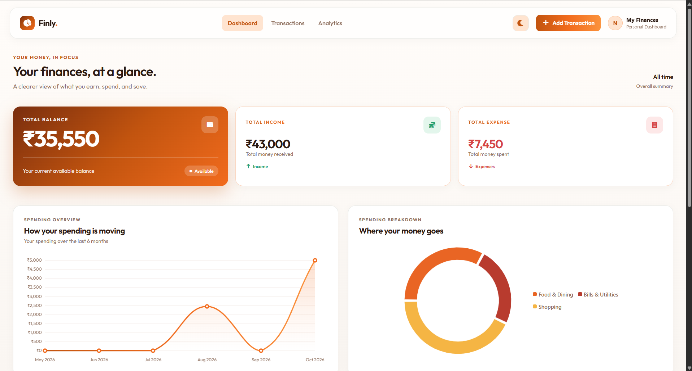
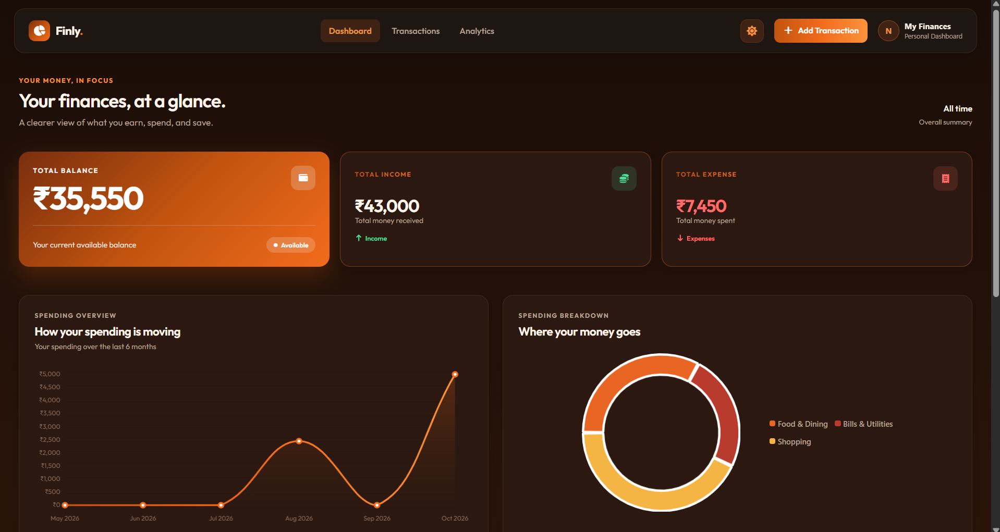
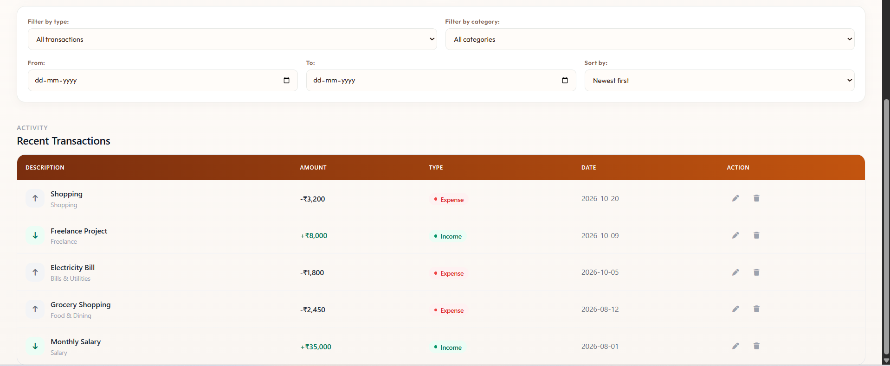

# Finly – Personal Expense Tracker

Finly is a personal expense tracker built with HTML, CSS and vanilla JavaScript. It helps users manage income and expenses, view their financial summary, and understand spending patterns through interactive charts.

Transaction data is saved in the browser using `localStorage`.

**Live Demo:** [View Finly](https://finly-expense-tracker.vercel.app/)

## Screenshots

### Dashboard – Light Mode

### Dashboard – Dark Mode

### Transactions

## Features

- Add, edit and delete transactions (CRUD operations)
- Dashboard displaying total balance, income and expenses
- Line chart showing financial activity over the last 6 months
- Doughnut chart displaying spending by category
- Filter transactions by type, category and date range
- Sort transactions by date and amount
- Light and dark themes
- Theme preference saved between visits
- Responsive design for desktop and mobile
- Input validation
- HTML escaping for safer rendering
- Data persistence using browser `localStorage`

## Tech Stack

- HTML
- CSS
- Vanilla JavaScript
- Tailwind CSS
- Chart.js
- Font Awesome
- Browser `localStorage`

## Note

Finly uses browser `localStorage` to save transaction data. Data is stored locally in the browser and is not synced across different devices or browsers.

## Author

Created as a personal learning project to practise JavaScript and explore frontend development concepts.
